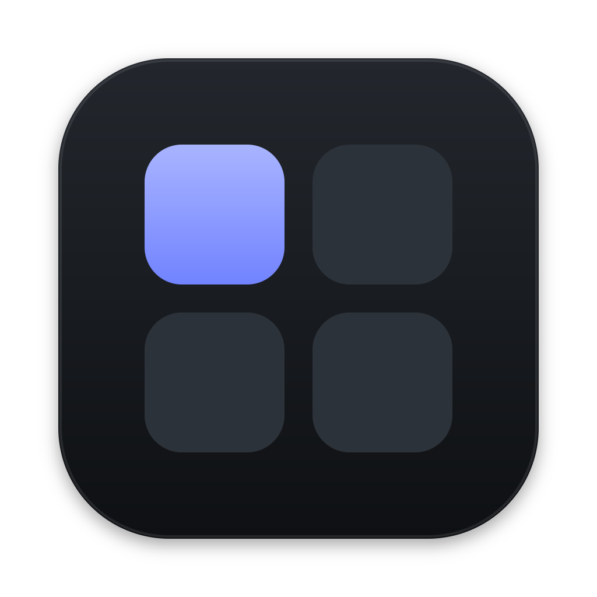
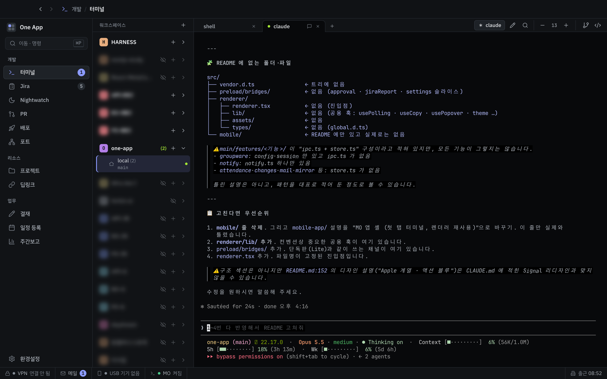
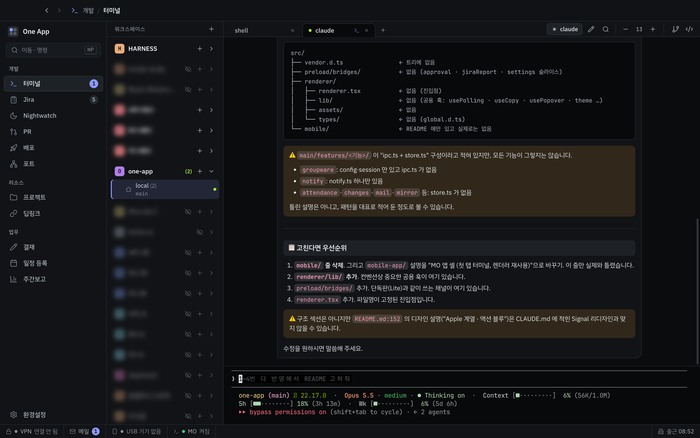
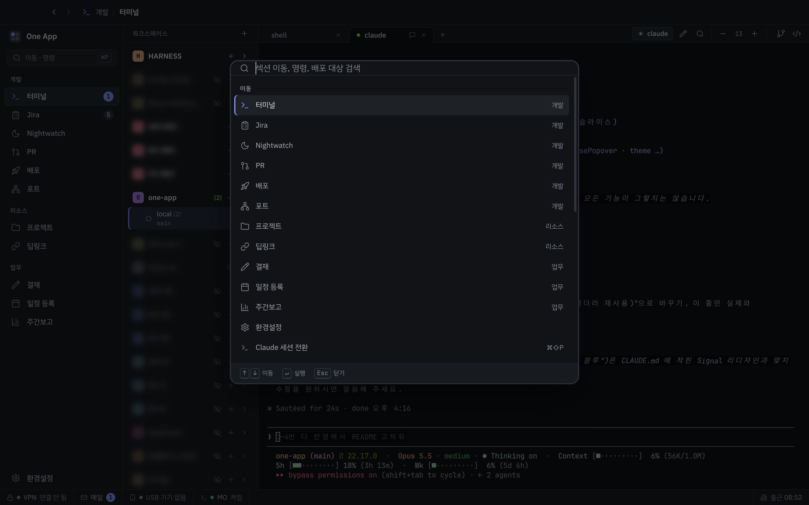
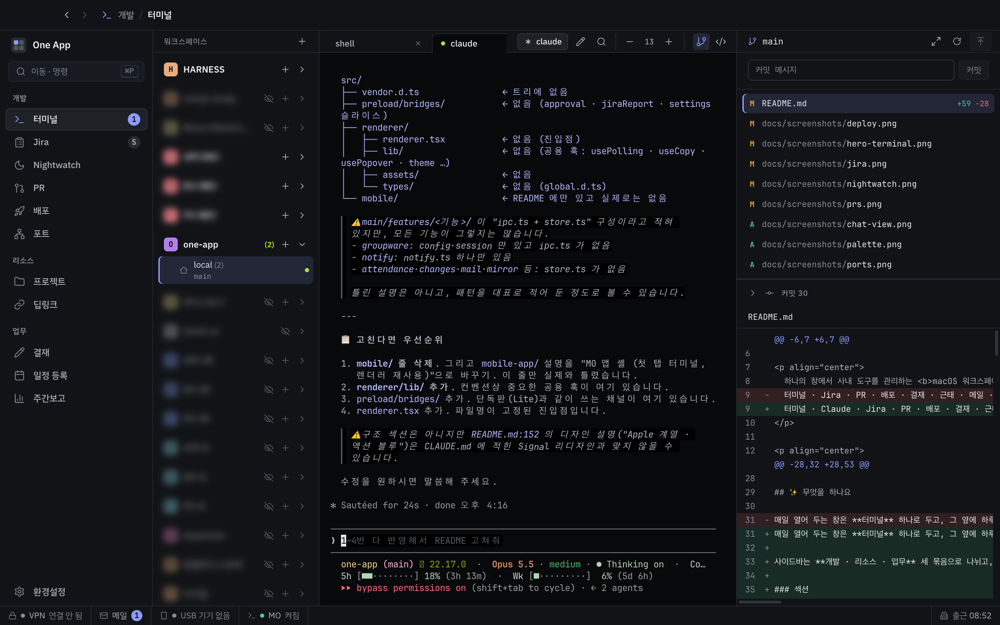
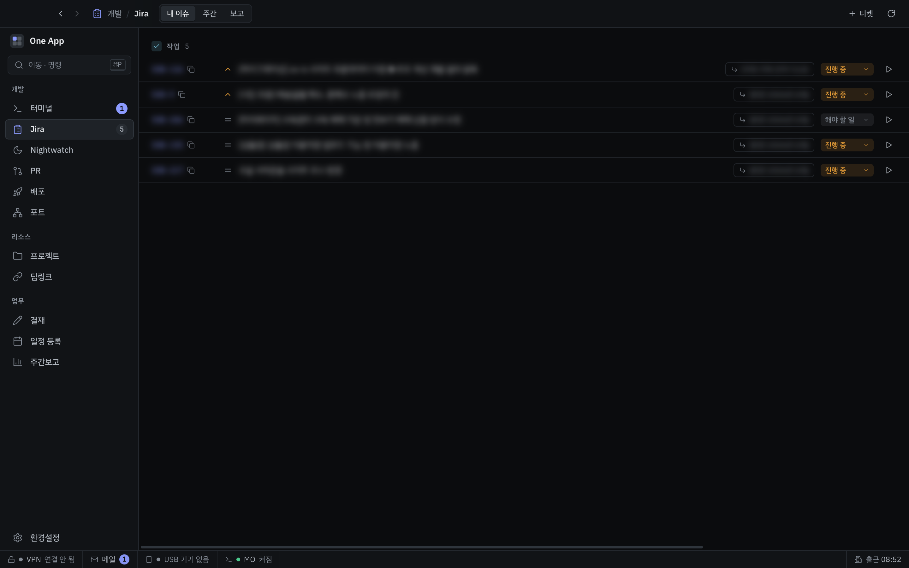
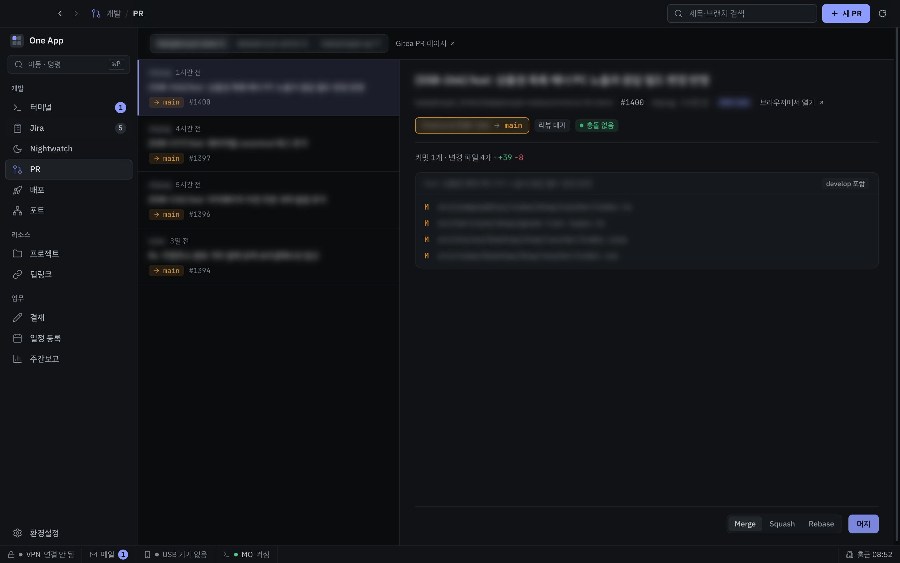
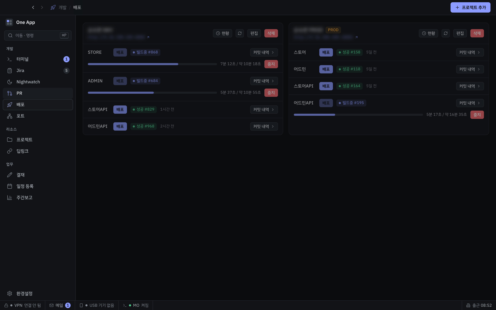
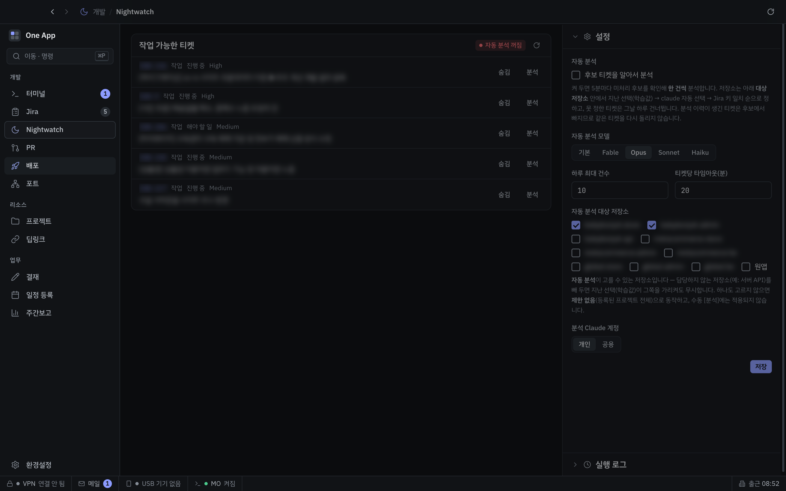
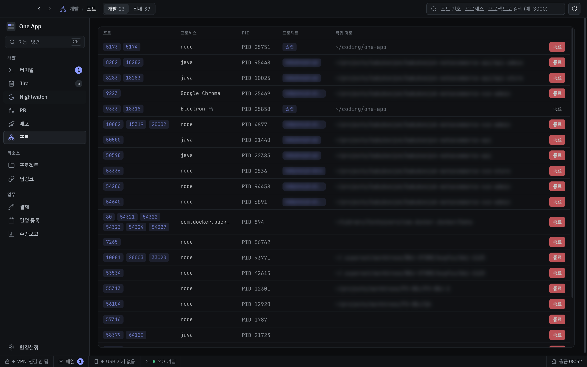

<p align="center">
  
</p>

<h1 align="center">One App</h1>

<p align="center">
  하나의 창에서 사내 도구를 관리하는 <b>macOS 워크스페이스 허브</b><br>
  터미널 · Claude · Jira · PR · 배포 · 결재 · 근태 · 메일 · VPN 을 창 하나로.
</p>

<p align="center">
  
  
  
  
  
  
</p>

<p align="center">
  
</p>

> 🇰🇷 사용자·코드·문서 모두 **한국어**로 작성합니다. 회사 내부 시스템(그룹웨어·Jira·Gitea·젠킨스)과 연동되는 개인 도구이며, 계정 정보는 저장소가 아니라 macOS 키체인(`safeStorage`)에만 보관합니다.

---

## ✨ 무엇을 하나요

매일 열어 두는 창은 **터미널** 하나로 두고, 그 옆에 하루 동안 오가는 사내 도구를 붙였습니다. 브라우저 탭을 열고, 로그인하고, 메뉴를 찾아 들어가는 수고를 없애는 것이 목표입니다.

사이드바는 **개발 · 리소스 · 업무** 세 묶음으로 나뉘고, 늘 확인하는 VPN·메일·폰·MO·출퇴근 상태는 창 아래 **상태바**에 둡니다. 어느 화면에서든 **⌘P** 로 섹션을 옮기거나 명령을 실행할 수 있습니다.

### 섹션

| 영역 | 기능 |
|---|---|
| 🖥️ **터미널** | tmux 백엔드 + xterm.js. 워크스페이스·워크트리별 세션, 분할, 팝아웃, 프리셋(claude·femc 등 에이전트를 한 번에 실행). 앱을 다시 켜도 세션이 유지되고, **컴퓨터를 재부팅해도 claude 대화를 이어서** 다시 띄움 |
| 💬 **채팅 보기** | claude 세션을 터미널 대신 **채팅으로 읽는 보기**(⌘E). 표·코드·체크리스트를 렌더링하고, 이미지·파일 첨부와 `@` 자동완성 지원 |
| 🔔 **입력 대기** | 세션을 '확인 전'과 '입력 대기'로 나눠 표시. 알림에서 claude 의 질문·권한 확인·플랜 승인에 **바로 답할 수 있음**. ⌘⇧P 로 모든 워크스페이스의 Claude 세션을 한 목록에서 전환 |
| 🔀 **변경사항** | 터미널 옆 드로어(⌘B)에서 git 상태·diff·커밋·푸시. 좌우 비교 diff 오버레이 |
| 📋 **Jira** | 내 이슈 목록·상태 전환·티켓 생성, 주간 활동, 레이블·에픽 필터로 보는 티켓 보고 |
| 🌙 **Nightwatch** | Jira 티켓을 골라 headless Claude 로 무인 분석해 리포트 작성 (수동 + 5분 주기 자동) |
| 🔃 **PR** | Gitea PR 목록·생성·머지, 충돌·리뷰 상태, 연결된 Jira 티켓 칩 |
| 🚀 **배포** | 젠킨스 잡 원클릭 실행, 커밋 미리보기, 진행률 표시, PROD 실행 전 확인 |
| 🔌 **포트** | 리스닝 포트를 프로세스·프로젝트별로 보고, 포트를 점유한 프로세스를 바로 종료 |
| 🗂️ **프로젝트 · 🔗 딥링크** | 배포·PR·터미널이 함께 쓰는 프로젝트 레지스트리, applink 생성 |
| ✍️ **결재 · 📅 일정 등록 · 📊 주간보고** | 야근·휴가·지출결의서 결재 자동 작성, 그룹웨어 일정 + 노션 기록, FE 챕터 주간 수집 → T/OT·MM 차트 |

### 상태바 · 백그라운드

| 영역 | 기능 |
|---|---|
| 🔒 **VPN** | OpenVPN + TOTP 자동 입력, 터널 생존 감시와 네트워크 전환 시 자동 재연결 |
| 📨 **메일** | 비즈박스 안 읽은 메일과 리더, 새 메일 알림음, 공용 계정 인증코드(피그마·유데미) 수신 |
| 📱 **폰 미러링 · MO** | scrcpy 미러링·제어. **MO** 는 같은 터미널 세션을 폰 브라우저에서 이어서 쓰는 모바일 화면(터미널·변경·Jira·PR·더보기 5탭, Tailscale 전용 + 토큰 인증, 웹 푸시 알림) |
| 🕘 **출퇴근** | 근태 기록·리마인더, 야근 결재 바로가기, 일정을 등록하지 않은 날은 다음 평일 아침에 알림 |
| 💤 **잠자기 감시** | 덮개를 닫은 뒤 반복해서 깨어나는지 감시하고, 잠자는 동안 폴링 중단·블루투스와 Wi-Fi 자동 끄기 |

---

## 📸 스크린샷

> 사내 정보(티켓 제목·저장소명·URL 등)는 블러 처리했습니다. 다크 테마 기준이며 라이트·시스템 테마도 지원합니다.

<table>
  <tr>
    <td align="center"><b>채팅 보기</b> — claude 대화를 채팅으로 읽기 (⌘E)</td>
    <td align="center"><b>명령 팔레트</b> — 섹션 이동·명령 실행 (⌘P)</td>
  </tr>
  <tr>
    <td></td>
    <td></td>
  </tr>
  <tr>
    <td align="center"><b>변경사항 드로어</b> — 터미널 옆에서 바로 diff·커밋 (⌘B)</td>
    <td align="center"><b>Jira</b> — 내 이슈와 상태 전환</td>
  </tr>
  <tr>
    <td></td>
    <td></td>
  </tr>
  <tr>
    <td align="center"><b>PR</b> — Gitea PR 확인·머지</td>
    <td align="center"><b>배포</b> — 젠킨스 잡 원클릭, PROD 보호</td>
  </tr>
  <tr>
    <td></td>
    <td></td>
  </tr>
  <tr>
    <td align="center"><b>Nightwatch</b> — Jira 티켓 무인 분석</td>
    <td align="center"><b>포트</b> — 리스닝 포트 확인·종료</td>
  </tr>
  <tr>
    <td></td>
    <td></td>
  </tr>
</table>

---

## 🚀 시작하기

### 요구사항

| 구분 | 내용 |
|---|---|
| OS | macOS (Electron 43) |
| 런타임 | Node.js 22 |
| 터미널 백엔드 | `brew install tmux` |
| 선택 | `scrcpy`(폰 미러링) · `openvpn`(VPN) · `claude` CLI(Nightwatch·프리셋·채팅 보기) · Tailscale(MO 접속) |

### 실행

```bash
npm install          # postinstall 이 node-pty 권한·fd 누수 패치를 함께 처리합니다
npm start            # 개발 모드 (렌더러 HMR)
```

> ⚠️ 개발 인스턴스는 설치된 앱과 **설정(userData)을 공유**하고 포트·tmux 소켓·창 상태만 분리합니다. 둘을 동시에 띄워 두는 것이 기본 사용 방식입니다.

### 빌드

```bash
npm run package      # .app
npm run make         # .app + 배포용 .zip  (macOS 는 ZIP maker 만 있습니다)
npm run icon         # 앱 아이콘·폰 홈 화면 아이콘 생성 (scripts/make-icon.mjs 의 도형 코드가 원본)
```

> ⚠️ 빌드는 자가서명 인증서로 서명합니다. 서명이 빠지면 키체인 접근 권한이 바뀌어 저장된 계정 정보를 다시 입력해야 합니다.

### 품질 검사

```bash
npx tsc --noEmit     # 타입 검사
npm run lint         # ESLint (exhaustive-deps 경고 0 유지)
npm test             # vitest — 순수 로직 단위 테스트
```

---

## 🧱 구조

Electron 의 세 컨텍스트를 엄격히 나누고, 렌더러↔메인 통신은 `preload` 가 노출한 `window.oneApp` 하나로만 합니다. 기능은 **feature 폴더 단위**(Bulletproof React 스타일)로 묶고, 기능 간 참조는 각 폴더의 `index.ts` 공개 API 로만 허용합니다.

```
src/
├── main/                  # 🖥️ 메인 프로세스 (Node)
│   ├── main.ts            #   창 생성 + register*Ipc()
│   ├── features/<기능>/   #   ipc.ts + 로직 + store.ts
│   └── lib/               #   http · store · broadcast · groupware · moIpc …
├── preload/
│   ├── preload.ts         # 🌉 contextBridge → window.oneApp
│   └── bridges/           #   단독판(Lite)과 함께 쓰는 채널 (결재 · 티켓 보고 · 환경설정)
├── renderer/              # 🎨 React UI
│   ├── renderer.tsx       #   React 마운트 진입점
│   ├── app/App.tsx        #   앱 셸(사이드바/탑바/상태바/메인) + SECTIONS
│   ├── components/        #   공용 UI (Button · Modal · Palette · StatusBar …)
│   ├── lib/               #   공용 훅 (usePolling · useCopy · usePopover · theme …)
│   ├── features/<기능>/   #   components/ + lib/ + index.ts
│   └── styles/            #   SCSS — _base.scss 디자인 토큰
├── mobile-app/            # 📱 MO 앱 셸 — 첫 탭이 터미널, 렌더러 재사용
└── shared/                # 🔗 공용 타입·프로토콜

standalone/lite/           # 📦 동료 배포용 단독 앱 One App Lite — 본체 코드를 @one/* 로 직접 import
```

| 항목 | 선택 |
|---|---|
| 프레임워크 | Electron 43 · React 19 · TypeScript 5 |
| 빌드 | Electron Forge + Vite 7 |
| 터미널 | node-pty + tmux · @xterm/xterm 6 (WebGL) |
| 스타일 | SCSS(`sass-embedded`) — 토큰 기반, 라이트/다크, IBM Plex Sans KR 번들 |
| 테스트 | vitest |
| 자동화 | 숨은 `BrowserWindow` 로 그룹웨어 작업 (외부 브라우저 의존 없음) |

---

## 🎨 디자인

**Signal** — 흑연색 바탕, **인디고 단일 액센트**, 정보를 촘촘하게 배치. 단축키·코드·숫자는 모노 글꼴로, 상태는 점과 문구로 표시합니다. 본문 글꼴은 IBM Plex Sans KR 입니다. 색·크기·모션은 모두 `src/renderer/styles/_base.scss` 토큰에서 가져오며 기준 문서는 [`DESIGN.md`](DESIGN.md) 입니다. 테마는 시스템/라이트/다크를 지원합니다.

---

## 📚 문서

| 문서 | 내용 |
|---|---|
| [`CLAUDE.md`](CLAUDE.md) | 작업 가이드 — 구조·컨벤션·반드시 지킬 것 |
| [`DESIGN.md`](DESIGN.md) | 디자인 시스템 (토큰 정본은 `_base.scss`) |
| [`ROADMAP.md`](ROADMAP.md) | 구현 완료 목록과 남은 로드맵 |
| [`.claude/rules/`](.claude/rules) | 기능별 상세 규칙·함정·실측 기록 |
| [`standalone/lite/`](standalone/lite) | 동료 배포용 단독 앱 One App Lite (결재 3종 + Jira 티켓 보고). GitHub Releases 로 배포하며 앱 안에서 바로 업데이트 |

---

## ⚠️ 알아둘 것

- 회사 내부 시스템 전용입니다. 그룹웨어·Jira·Gitea·젠킨스 주소와 계정은 **환경설정**에서 입력하며 코드에는 없습니다.
- 비밀은 `safeStorage`(키체인)로 암호화해 `userData` 에만 저장합니다. 키체인을 쓸 수 없는 환경에서는 환경설정에 경고가 표시됩니다.
- 그룹웨어는 같은 계정의 동시 로그인을 거부하므로 앱은 **공용 세션 하나**를 재사용합니다.

## 📄 라이선스

MIT
